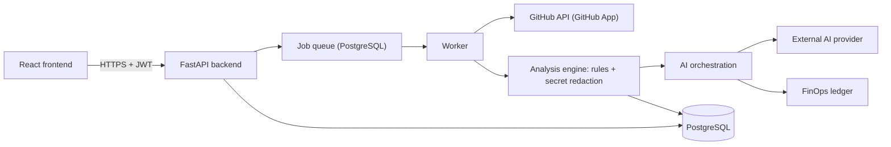

# ROCKSPIRE_SOFY
# 🚀 ROCKSPIRE SOFY

**An AI-powered software development intelligence platform with a mission-control, rocket-building interface.**

Rockspire Sofy connects to your GitHub repositories, analyzes them with evidence-backed AI and rules, compares your project's demonstrated skills against a job description, turns every gap into a measurable mission, and tracks the platform's own AI and cloud costs along the way.

> **Project status: planning complete, implementation starting.**
> The full product blueprint (architecture, API, database schema, security model, roadmap) is written. The application code is being built milestone by milestone. Nothing below should be read as "already shipped" unless it is marked ✅ in the [Roadmap](#roadmap).

---

## Table of contents

1. [What is Rockspire Sofy?](#what-is-rockspire-sofy)
2. [The problem it solves](#the-problem-it-solves)
3. [Core ideas](#core-ideas)
4. [Features](#features)
5. [The rocket metaphor](#the-rocket-metaphor)
6. [How it works](#how-it-works)
7. [Tech stack](#tech-stack)
8. [FinOps: cost as a first-class feature](#finops-cost-as-a-first-class-feature)
9. [Security and privacy principles](#security-and-privacy-principles)
10. [Roadmap](#roadmap)
11. [Repository structure](#repository-structure)
12. [Getting started](#getting-started)
13. [Documentation](#documentation)
14. [Contributing](#contributing)
15. [License](#license)

---

## What is Rockspire Sofy?

-Rockspire Sofy is a platform for developers who want an honest answer to three questions about their projects:

1. **How good is this project, really?** -Findings come with file and line references, and each is labelled *confirmed*, *possible*, or *suggestion*.
2. **Does this project prove the skills a job asks for?** -Paste a job description and see which requirements the repository *demonstrates*, *partially demonstrates*, or leaves *unverified*.
3. **What should I do next, and what will it cost?** -Findings and skill gaps become prioritized **missions**, and every AI call is tracked with usage and estimated cost.

The interface is a futuristic **mission-control dashboard** where the parts of a rocket represent areas of software quality. Completing missions fills in the rocket.

## The problem it solves

- Developers (especially students and job seekers) often don't know which parts of a portfolio project are weak, or which skills it actually proves.
- Generic AI code review tends to sound confident without showing evidence.
- AI features quietly create cloud bills, and most side projects never measure them.

Rockspire Sofy addresses these by requiring **evidence for every claim**, **human approval for every change**, and **visibility into every cost**.

## Core ideas

| Principle | What it means in practice |
|---|---|
| **Evidence first** | No evidence, no claim. Findings cite files and line ranges, and the system verifies the citations exist. |
| **No fabrication** | Job requirements come only from text the user pastes. The platform never invents job listings or user qualifications. "Unverified" means *this repository shows no evidence*, not *you lack the skill*. |
| **Human in the loop** | Mission AI proposes changes as diffs. Nothing is applied or pushed without explicit approval, and pushes go to a new branch and pull request. |
| **Cost transparency** | Every number is labelled **ACTUAL** (provider billing data) or **ESTIMATE** (computed). Savings are never claimed without stated assumptions and a measurement plan. |
| **Least privilege** | GitHub access starts read-only through a GitHub App with short-lived tokens. Source code is not stored long term. |

## Features

Legend: **MVP** = first release · **Release 2** = after the MVP · **Later** = future ideas.

### 🛰️ Launchpad dashboard — MVP
Connected projects, project health, recent analysis, active missions, career goals, and cost summary in one place.

### 🐙 GitHub Intelligence — MVP
GitHub App authorization, repository selection (public and private where authorized), repository tree, README, dependencies, languages, branches, and (where permitted) issues and pull requests. **Incremental analysis** re-processes only files whose content hash changed.

### 🔍 AI Project Intelligence — MVP
Project type and technology detection, plus analysis of architecture, code quality, testing, documentation, security, deployment, reliability, and modernization opportunities. Deterministic rules run first; AI reviews only changed, redacted chunks.

### 💼 Career Intelligence — MVP
Paste a job description, extract requirements, and compare them with repository evidence. Produces a prioritized improvement roadmap. Resume analysis is a *Later* feature.

### 🧭 Rocket Builder — MVP
An interactive rocket whose parts map to software capabilities, with measurable completion criteria and launch-readiness gates. Project-specific blueprints let you disable components that don't apply.

### 🎯 Missions — MVP
Concrete, measurable tasks generated from findings, failed criteria, job-skill gaps, and cost recommendations. A mission is **verified** only when re-analysis shows the improvement.

### 💰 FinOps Intelligence — MVP (lite) / Release 2 (full)
Usage ledger, estimated cost per analysis, cache hit rate, budgets with hard caps. Later: billing import, anomaly alerts, serverless vs non-serverless comparison, and FinOps missions with before-and-after proof.

### 🤖 Mission AI — Release 2
Explain code, propose diffs, generate tests and documentation, help debug, and review changes, all behind an approval gate.

### 👥 Crew Mode — Release 2
Team invitations, roles, shared projects, component ownership, GitHub issue and pull-request links, and team progress.

## The rocket metaphor

> **This is a product metaphor, not a standard software-engineering classification.** It exists to make progress visible and memorable. The scoring criteria and evidence underneath each part are what carry the rigor.

| Rocket part | Software capability |
|---|---|
| Nose cone | Project vision and documentation |
| Payload | Core application features |
| Avionics | Application logic and integrations |
| Navigation system | Testing, observability, and reliability |
| Fuel system | Dependencies, configuration, and resource efficiency |
| Engine | Core processing and backend functionality |
| Structural body | Architecture and maintainability |
| Stabilization fins | Security and resilience |
| Launch system | Deployment and release readiness |

**How progress is calculated:** each component has weighted criteria (pass = 1, partial = 0.5, fail or unverified = 0). Component completion is the weighted average of applicable criteria. Overall progress is the weighted average of enabled components. **Launch Ready** additionally requires gates, for example no open critical confirmed security finding, so a high average can never hide a serious problem.

## How it works



**Repository analysis in short**

1. You click *Analyze*. The API checks permissions and your budget, queues a job, and replies immediately.
2. The worker fetches the file tree. Each file has a content hash, so only changed files are fetched.
3. Changed files are scanned for secrets (redacted) and checked against static rules.
4. Remaining chunks go to the AI with a strict JSON schema. Repository text is treated as untrusted data.
5. Every finding is verified (file exists, lines in range, snippet matches) before it is saved. Failed ones are dropped.
6. Usage and estimated cost are recorded, and results appear in the dashboard.

## Tech stack

| Area | Choice | Notes |
|---|---|---|
| Frontend | React, TypeScript, Vite, Tailwind CSS, shadcn/ui, Framer Motion | Rocket drawn as animated SVG; 3D (Three.js) is a later option |
| Backend | Python + FastAPI | One backend only; Pydantic validates AI output |
| Database | PostgreSQL (Supabase) | Also used for the job queue and cache in the MVP |
| Auth | Supabase Auth (GitHub sign-in) | Backend verifies the JWT |
| GitHub access | GitHub App | Read-only first; short-lived installation tokens |
| AI | Provider-agnostic adapter | Free tiers only for public or demo repos |
| Hosting | Vercel (frontend), Render (API), Supabase (database) | Free-tier first; verify current limits |

> Free-tier limits and prices change. Check each vendor's official pricing page before relying on them.

## FinOps: cost as a first-class feature

- Every AI call writes a usage event: model, tokens, cache status, estimated cost.
- Prices live in a database table with a source URL and verification date, never hard-coded.
- **Pre-flight estimates** before each job, **budget thresholds**, a **hard cap**, and an environment **kill switch**.
- **Caching:** results are keyed by file hash, analyzer version, prompt version, and model, so unchanged files are never re-analyzed.
- Optimizations are proven with **before-and-after measurements** over comparable runs. If the data is unclear, the saving is marked *unproven*.

## Security and privacy principles

- GitHub App with least-privilege permissions; private keys only in environment or secret storage; **no tokens stored**.
- Source code is fetched into memory per job and **not stored long term**. Only hashes and short redacted evidence snippets are kept.
- **Prompt-injection defenses:** repository text is delimited as data; analysis calls have no tools; outputs must match a schema; model output is never executed automatically.
- **Secret detection and redaction** before any content leaves the server. Secret findings never include the secret value.
- **No code execution on the servers** in the MVP. Tests later run in the user's own GitHub Actions.
- Role-based access (owner, admin, member, viewer) enforced centrally, with automated authorization tests.
- Defined retention and deletion for projects, job descriptions, and usage data.

## Roadmap

| # | Milestone | Release | Status |
|---|---|---|---|
| 1 | Product specification and design | MVP | ✅ Blueprint written |
| 2 | Frontend with mock data | MVP | ⏳ Next |
| 3 | Backend foundation | MVP | ⬜ |
| 4 | Database and authentication | MVP | ⬜ |
| 5 | GitHub integration | MVP | ⬜ |
| 6 | Repository analysis | MVP | ⬜ |
| 7 | AI recommendations | MVP | ⬜ |
| 8 | Rocket Builder (live data) | MVP | ⬜ |
| 9 | Job matching | MVP | ⬜ |
| 10 | FinOps (lite) | MVP | ⬜ |
| 11 | Mission AI | Release 2 | ⬜ |
| 12 | Crew Mode | Release 2 | ⬜ |
| 13 | Testing and security | Both | ⬜ |
| 14 | Deployment | Both | ⬜ |

**Not in the MVP:** Mission AI code changes and pushes, Crew Mode, cloud billing import, webhooks, resume analysis, 3D rocket, multi-repo projects, running user code.

## Repository structure

*Planned layout; folders appear as milestones are completed.*

```text
rockspire-sofy/
├─ README.md
├─ docs/                  # blueprint, architecture diagrams, decision records
├─ apps/
│  ├─ web/                # React + TypeScript + Vite frontend
│  └─ api/                # FastAPI backend, worker, migrations, tests
├─ infra/                 # deployment configuration
├─ fixtures/              # recorded GitHub responses, test data
├─ .github/workflows/     # CI/CD
└─ .env.example           # variable names only, never values
```

## Getting started

Setup instructions will be added as soon as there is something to run. The first runnable piece will be the frontend with mock data (Milestone 2), which also becomes the **Demo Mode**.

```bash
# Coming with Milestone 2
cd apps/web
npm install
npm run dev
```

**Never commit secrets.** Keep keys in environment variables and list only their names in `.env.example`.

## Documentation

- `docs/blueprint.pdf`: the complete product blueprint (vision, requirements, modules, architecture, API, database schema, security, UI inventory, roadmap, testing, deployment, FinOps strategy, risks)

## Contributing

This is currently a personal portfolio project. Issues and suggestions are welcome; please open an issue before starting larger changes.

## License

License to be decided. Add a `LICENSE` file before accepting outside contributions.

---

*Rockspire Sofy is a learning and portfolio project. Its analysis results are aids for human judgment, not guarantees, and the job-matching feature reports repository evidence only; it does not predict hiring outcomes.*
